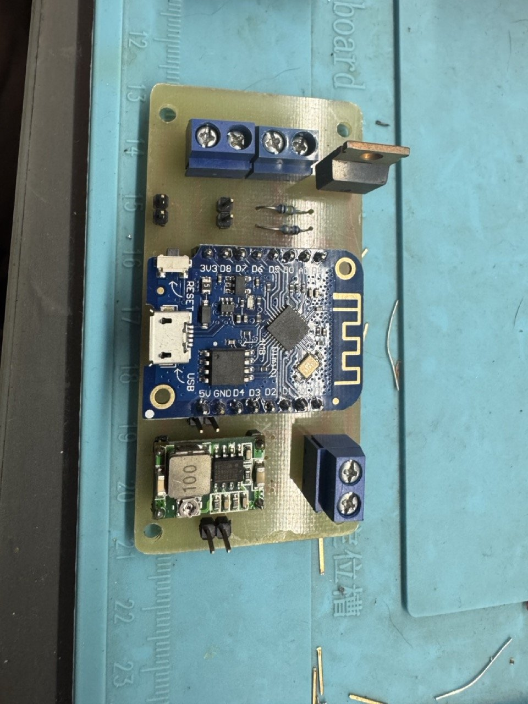

# DOMCOM Dimmer

Zigbee dimmer for single-colour LED strips (12/24 V DC, low-side MOSFET) on
an ESP32-C6. It works with Zigbee2MQTT and Home Assistant, keeps working
without a network, has a local push button, and updates itself over Zigbee
with patches of a few kilobytes.

<p align="center">
  
</p>

It started as the replacement for an ESPHome dimmer on a Wemos D1 mini
(ESP8266, Wi-Fi); that YAML is kept, without secrets, in
[`legacy/`](legacy/dimmer-taller.yaml).

## Status

Work in progress, running on the original hand-made board with an ESP32-C6
wired in. A dedicated PCB comes later ([roadmap](docs/ROADMAP.md)).

| | |
|---|---|
| Zigbee2MQTT 2.13 | tested: pairing, light, settings, effects, power-on behaviour, OTA |
| Full OTA with rollback | tested on the board (0.3.0 → 0.3.1) |
| Delta OTA | built and checked on the computer; first test on the board pending |
| Home Assistant ZHA | not tested yet (a standard Dimmable Light, so it should pair) |
| Hardware | the legacy board only; no PCB files yet |

## Features

- **Zigbee 3.0 router** (it strengthens the mesh), standard *Dimmable Light*
  (device 0x0101): on/off, brightness, transitions, power-on behaviour.
- **Silent PWM:** 19.5 kHz, above the audible band, with ~16 effective bits
  (12 bits plus 4 dithered by the C6 LEDC).
- **Brightness curve:** gamma 2.8 (as ESPHome) with an adjustable floor, so
  the lowest brightness already lights the strip.
- **Local button:** press to toggle, hold to dim (the direction alternates
  on every hold). A long press never does anything else.
- **Works offline:** the button and the power-up state never depend on the
  network. The state is saved to flash and restored according to
  *power-on behaviour*.
- **Identify and effects:** blink, breathe, okay, channel change.
- **Settings over Zigbee:** minimum output, gamma and button ramp time,
  kept in flash; with the [external converter](extras/z2m/domcom_dimmer.js)
  they are regular settings in Zigbee2MQTT and Home Assistant.
- **Firmware updates over Zigbee:** a delta patch when the device runs a
  known version (typically 1–6 % of the image: a minute instead of an
  hour), the full image otherwise; checked before and after writing, with
  automatic rollback if a new version does not start
  ([docs/OTA.md](docs/OTA.md)).
- **Leaving the network** only by holding the board's BOOT button for
  10 s, or by removing the device from the coordinator.

## Getting started

You need an ESP32-C6 board (Super Mini, DevKitC, C6-Zero…), a logic-level
N-MOSFET driving the strip's negative wire, a 5 V supply for the board,
and optionally a push button to GND.

1. **Wire it** as in [docs/HARDWARE.md](docs/HARDWARE.md#test-wiring):
   GPIO18 to the MOSFET gate (through a resistor, with a pull-down),
   GPIO19 to the button, GND and 5 V. Pins are configurable.
2. **Build and flash** with ESP-IDF 5.5 ([docs/FIRMWARE.md](docs/FIRMWARE.md)):

   ```bash
   cd firmware
   idf.py build
   idf.py -p PORT flash
   ```

3. **Pair it:** *Permit join* in Zigbee2MQTT. The strip blinks twice when
   it joins.
4. **Install the external converter** for the settings and OTA
   ([docs/ZIGBEE.md](docs/ZIGBEE.md#installing-the-converter)).
5. **Updates** from then on go over the air ([docs/OTA.md](docs/OTA.md)).

## Documentation

| Document | Contents |
|---|---|
| [docs/HARDWARE.md](docs/HARDWARE.md) | The board, test wiring, pin choices, what was measured (hum, MOSFET, minimum) |
| [docs/ZIGBEE.md](docs/ZIGBEE.md) | Clusters, behaviour, effects, settings cluster, Zigbee2MQTT converter, leaving the network |
| [docs/FIRMWARE.md](docs/FIRMWARE.md) | Build, flash, configuration, code layout, flash storage |
| [docs/OTA.md](docs/OTA.md) | Updates over Zigbee: full images, delta patches, Zigbee2MQTT setup, rollback |
| [docs/ROADMAP.md](docs/ROADMAP.md) | What is done and what comes next |
| [CHANGELOG.md](CHANGELOG.md) | Changes per version |

## Safety

This is a low-voltage DC device: the strip and the board run from a 12 or
24 V supply. Do not connect anything here to mains. Size the MOSFET, the
wiring and the supply for the strip's current, and fuse the supply.

## License

[PolyForm Noncommercial 1.0.0](LICENSE): free for any non-commercial use,
including personal projects, study and research. Commercial use needs a
separate license from the author.

Third-party code, each under its own license: Espressif's esp-zigbee-lib
and esp-zboss-lib, esp_delta_ota (Apache-2.0) with detools (BSD-2-Clause)
and heatshrink (ISC).
