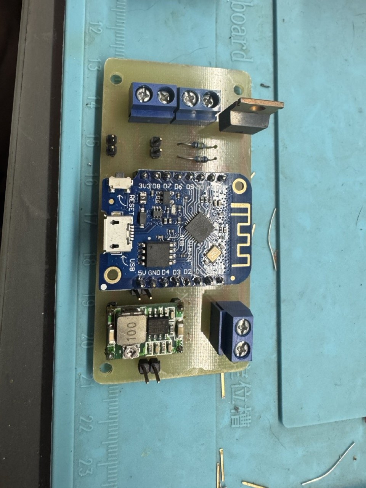
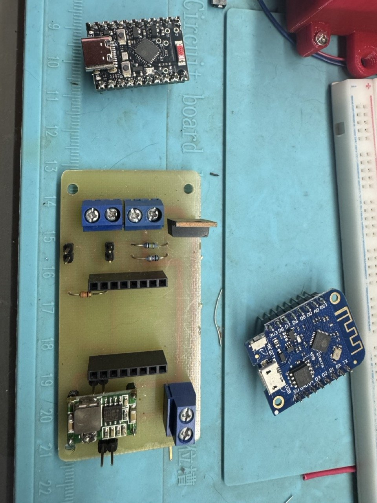

# Hardware

## Legacy board

The first board, hand-made, was built for a Wemos D1 mini (ESP8266) running
ESPHome ([`legacy/dimmer-taller.yaml`](../legacy/dimmer-taller.yaml)):

- Mini360 buck converter, 12 V → 5 V for the module.
- TO-220 MOSFET, low side, gate driven from the GPIO through a series
  resistor, with a pull-down.
- Push button to GND on an input with the internal pull-up.
- Screw terminals for the supply, the strip and the button.

On the D1 mini the PWM was on GPIO14 (D5) and the button on GPIO13 (D7).

  
  

## Test wiring

During development the ESP32-C6 is wired to the D1 mini socket with jumper
cables:

| D1 mini socket | Function on the board | ESP32-C6 |
|---|---|---|
| D5 (GPIO14) | MOSFET gate, through the resistor | **GPIO18** |
| D7 (GPIO13) | button to GND | **GPIO19** |
| 5V | Mini360 output | 5V |
| G | GND | GND |

GPIO18 and GPIO19 exist on the ESP32-C6 Super Mini, the DevKitC and the
Waveshare C6-Zero, and are not strapping pins (on the C6 those are 4, 5, 8,
9 and 15). The board's BOOT button (GPIO9) is read too: it is only a strapping
pin at power-up.

**While the C6 is plugged into a computer over USB, leave the 5 V wire
disconnected**: GND and the two signals are enough (the strip still runs
from the 12 V supply), and USB and the Mini360 do not fight each other.

All pins are configurable in `menuconfig` (see [FIRMWARE.md](FIRMWARE.md)).

## Findings on the legacy board

### PWM frequency: audible hum at 4 kHz

The first firmware ran the PWM at 4 kHz. The strip hummed at intermediate
brightness and was silent at 100 % (no switching). The likely source is the
strip's ceramic capacitors (and/or the converter's inductor) vibrating at
the PWM frequency; 4 kHz falls where hearing is most sensitive (2–5 kHz).

The ESPHome original used `esp8266_pwm` at its default 1 kHz: software PWM
driven by a timer interrupt, about 10 effective bits at that frequency, with
some jitter when Wi-Fi is busy.

Since v0.1.1 the PWM runs at **19.5 kHz**: no audible hum. At that frequency
the LEDC gives only 12 integer bits (80 MHz / 19.5 kHz), but the C6 duty
register has 4 fractional bits that the hardware dithers over 16 periods,
so the low end keeps ~16 bits of resolution.

### MOSFET temperature

At 19.5 kHz the MOSFET switches ~5× more often than at 4 kHz, and with the
gate driven through a resistor the edges are slow. Measured: **several hours
at 50 % with the strip loaded, the MOSFET stays cold.**

### Dead zone below ~5 % duty

With v0.1.1 (minimum output 0.1 %) the strip only started to glow at about
level 87 of 254, i.e. ~5 % duty. At 19.5 kHz a period lasts 51 µs, so 1 % is
a 0.5 µs pulse, too short for a gate charged through a resistor to turn
the MOSFET on.

Since v0.2.0 the curve starts at **5 %**: level 1 is the first visible glow
and the whole slider is useful. The value is adjustable over Zigbee without
reflashing ([ZIGBEE.md](ZIGBEE.md#settings-cluster-0xfc00)), because it
depends on the hardware: a proper gate driver should bring it well below
1 %.

## Next board (planned)

See the [roadmap](ROADMAP.md). Notes so far:

- HW-613 buck converter instead of the Mini360.
- Logic-level MOSFET with a gate driver (fast edges at ~20 kHz, lower
  minimum).
- The BOOT button reachable (it is the button that leaves the network), the
  external button on its own terminal.
- A jumper reserved for choosing Zigbee or Wi-Fi, if that phase goes ahead.
